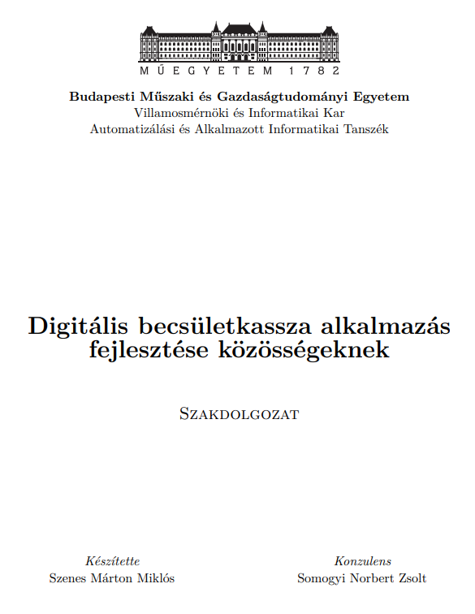

# Digitális becsületkassza alkalmazás fejlesztése közösségeknek

BSc szakdolgozat (BME VIK, Automatizálási és Alkalmazott Informatikai Tanszék) a **KasszaSCH** rendszerről.

- **Szerző:** Szenes Márton Miklós
- **Konzulens:** Somogyi Norbert Zsolt

**[Szakdolgozat megnyitása (PDF)](thesis.pdf)**

